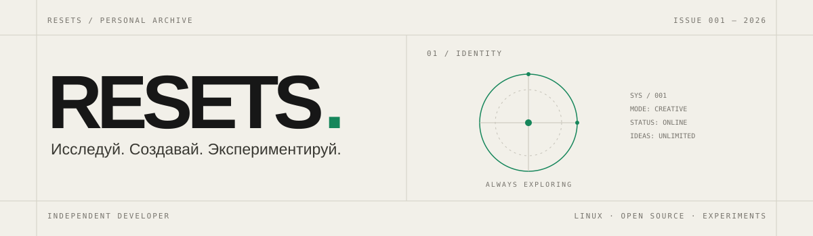

 <!-- ReSets / Personal Archive -->

<p align="center">
  <picture>
    <source media="(prefers-color-scheme: dark)" srcset="assets/hero-dark.svg">
    
  </picture>
</p>

<p align="center">
  <sub>INDEPENDENT DEVELOPER · LINUX ENTHUSIAST · DIGITAL EXPERIMENTER</sub>
</p>

<p align="center">
  <a href="https://t.me/linux0nly">TELEGRAM</a>
  &nbsp;·&nbsp;
  <a href="mailto:resetsgitmes@gmail.com">EMAIL</a>
  &nbsp;·&nbsp;
  <a href="https://github.com/ReSets">GITHUB</a>
</p>

---

## 01 — INTRODUCTION

### Привет, я ReSets.

Я люблю исследовать технологии, экспериментировать с необычными решениями и создавать собственные цифровые продукты.

Меня привлекает не только то, как работают технологии, но и то, что можно построить с их помощью.

Мой основной интерес — Linux, Open Source, искусственный интеллект, разработка программного обеспечения и создание необычных интерфейсов.

> Мне нравится не просто пользоваться готовыми решениями. Мне нравится разбираться, как они устроены, менять их под себя и создавать что-то своё.

---

## 02 — AREAS OF INTEREST

| Направление | Что меня интересует |
|:--|:--|
| `LINUX` | Gentoo, Linux ecosystem, system customization |
| `DESKTOP` | Niri, Wayland, terminal aesthetics, ricing |
| `OPEN SOURCE` | Open-source software, community projects |
| `AI` | AI agents, OpenCode, AI-assisted development |
| `WEB` | Experimental interfaces, UI/UX, digital products |
| `CREATIVE` | Unusual concepts, independent projects, design experiments |

---

## TOOLBOX

**OPERATING SYSTEMS**

Linux · Gentoo · Wayland

**DESKTOP ENVIRONMENT**

Niri · Kitty

**DEVELOPMENT & AI**

OpenCode · AI Agents · Git

**CREATIVE TOOLS**

SVG · Markdown · UI/UX Design

*The toolbox is constantly evolving.*

---

## CURRENTLY EXPLORING

```text
[01] Exploring the Linux ecosystem
[02] Experimenting with AI-assisted development
[03] Building independent digital products
[04] Designing unusual user interfaces
[05] Learning by breaking and rebuilding things
```

---

## PERSONAL PHILOSOPHY

- Curiosity over routine.
- Understanding over blindly following instructions.
- Experimentation over conventional solutions.
- Open Source over unnecessary restrictions.
- Building over just talking about ideas.

---

## CONNECT

Есть интересная идея, проект или просто желание обсудить технологии?

Буду рад знакомству.

<p align="center">
  <a href="https://t.me/linux0nly">TELEGRAM ↗</a>
  &nbsp;&nbsp; / &nbsp;&nbsp;
  <a href="mailto:resetsgitmes@gmail.com">EMAIL ↗</a>
</p>

---

<p align="center">
  <sub>DESIGNED WITH CURIOSITY · POWERED BY EXPERIMENTATION</sub>
</p>

<p align="center">
  <sub>© 2026 RESETS — PERSONAL DIGITAL ARCHIVE</sub>
</p>
